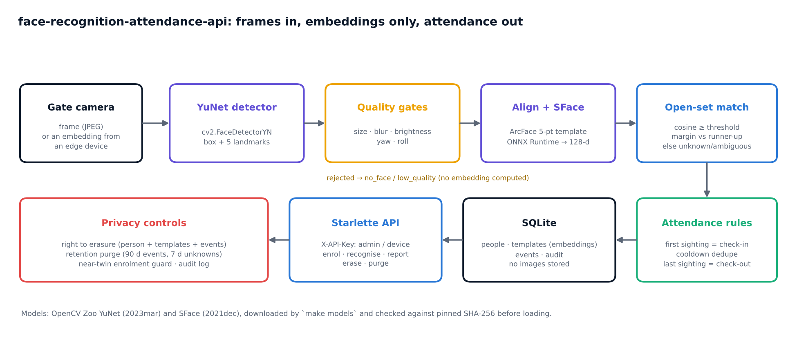
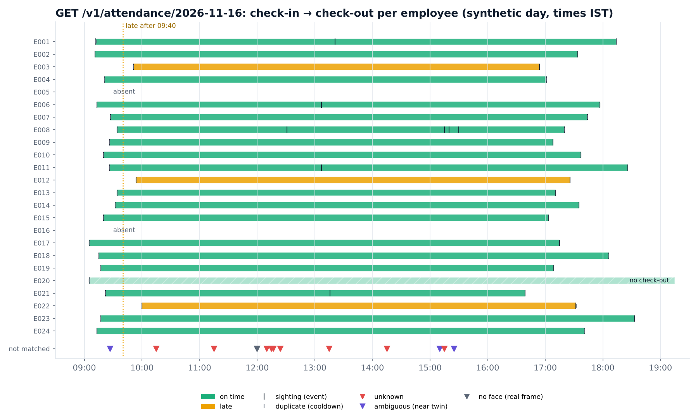
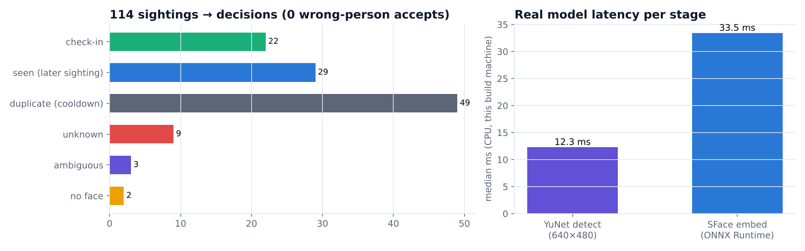
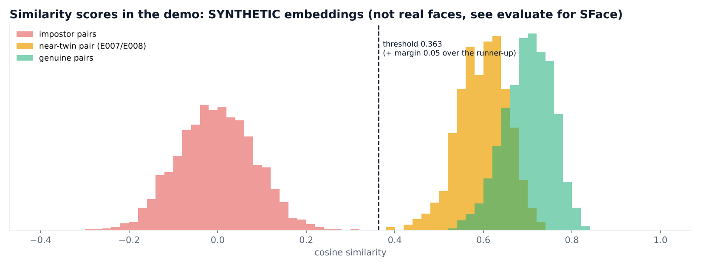

# Face Recognition Attendance API

[](https://github.com/vishavjit-singh/face-recognition-attendance-api/actions/workflows/ci.yml)


An attendance service for a gate camera. **YuNet** finds the face and its five landmarks, quality gates reject frames that would give a poor match, the face is aligned to the ArcFace template, and **SFace** turns it into a 128-d embedding on **ONNX Runtime**. An **open-set matcher** then decides *who*, *nobody we know* or *too close to call*. Accepted sightings become check-ins and check-outs with cooldown deduplication, and an **ASGI API** serves enrolment, recognition and daily reports.

Privacy is part of the design, not an add-on:

- Only embeddings are stored, never images.
- Deleting a person removes every template and event about them.
- Retention purges old events, and unmatched sightings are purged after 7 days.
- A guard stops one face being enrolled as two people.
- Every admin action is audited.



## Why this project

| Problem with face attendance | How the service handles it |
|---|---|
| Blurry, dark, tiny or turned faces cause wrong matches | **Quality gates** before embedding: face size, Laplacian sharpness, brightness, yaw from the nose offset, roll from the eye line. Rejects say why (`blurry`, `not_frontal`, …) |
| A threshold alone accepts the nearest stranger | **Open-set matching**: accept only if cosine ≥ threshold **and** the best person beats the runner-up by a margin. Otherwise the result is `unknown` or `ambiguous`, never a guess |
| Twins and look-alikes | The margin rule returns `ambiguous` instead of picking one. At enrolment, a template that already matches another person is refused (`matches_other_person`) unless an admin forces it, and the override is audited |
| A camera sees the same person in 5 consecutive frames | Per-person **cooldown**: sightings inside 120 s are recorded as `duplicate`, not new events |
| A lunch walk past the camera ends someone's day | **First in, last out**: check-out is the *last* sighting at least 30 min after check-in, derived in the report |
| Face images are sensitive biometric data | Images are never persisted, only 512-byte embeddings. `DELETE /v1/people/{id}` erases the person, their templates and events. Retention purge runs at 90 days for events and 7 days for unmatched sightings |
| A tampered or swapped model file | Models are downloaded from OpenCV Zoo and checked against **pinned SHA-256** before they load. A bad download is removed, never half-written |
| Edge cameras with their own NPU | `POST /v1/recognize` also accepts an SFace embedding instead of a frame (can be switched off) |
| Gate devices shouldn't administer the system | Two **API-key roles**: `device` may only recognise; `admin` enrols, reports, erases and purges. Keys come from the environment and several can be set for rotation |

## Results

> **What is real and what is synthetic.** The demo exercises the **real YuNet and SFace models** on frames that contain no face. It runs the **matching and attendance logic** on **synthetic embeddings**: fictional identities as random vectors plus capture noise. The repository contains no face photos. Accuracy on real faces is measured by the `evaluate` job in CI on the Olivetti research faces, and its numbers live in that job's artifact, not in this README.

### 1. Real-model checks (`make demo`, part 1)

| Check | Result |
|---|---|
| Models | YuNet 2023mar and SFace 2021dec from OpenCV Zoo, SHA-256 verified |
| Detections on faceless frames (blank, noise, gradient) | 0, 0, 0 |
| SFace via ONNX Runtime vs OpenCV's own `FaceRecognizerSF.feature` | cosine 1.0 (identical) |
| Our 5-point alignment vs OpenCV's `alignCrop` | mean absolute pixel difference 0.0 |
| Embedding | 128-d, L2 norm 1.0 |
| Median latency on the build machine (shared CPU, varies between runs) | detect 640×480 ≈ 12 ms · embed ≈ 33 ms in the run shown below |

### 2. One working day through the API (`make demo`, part 2, synthetic embeddings)

24 fictional employees are enrolled with 3 templates each. The near-twin pair E007/E008 trips the enrolment guard 3 times, and each time an admin overrides it with the override audited. The gate then reports 114 sightings between 08:40 and 19:10:

- walk-ins seen in several frames
- a lunchtime walk-past
- poor captures
- 6 strangers
- noisy captures of the near-twin
- two real frames with no face





| Outcome (synthetic day) | Count |
|---|---|
| Sightings | 114 |
| Accepted | 100: 22 check-ins, 29 later sightings, 49 duplicates suppressed by the cooldown |
| Wrong person accepted | **0** |
| Strangers accepted | **0** of 6 |
| Near-twin captures returned as `ambiguous` | 3 |
| Poor captures (heavy noise) | 3 rejected as `unknown`, 1 accepted |
| Real faceless frames | 2 × `no_face` |
| Daily report | 19 on time, 3 late, 2 absent, 1 missing check-out |
| Erasure of one person at the end | 3 templates + 6 events deleted |

Where the synthetic scores sit relative to the threshold. The near-twin pair overlaps the genuine scores, which is why the margin rule exists:



### 3. Accuracy on real faces (CI `evaluate` job)

`make evaluate` runs the full pipeline on the 400 Olivetti faces (AT&T Laboratories Cambridge, 40 subjects, fetched by scikit-learn) and writes `reports/evaluation.json` and `reports/evaluation_roc.png`. It reports:

- **detection rate**
- **verification:** ROC AUC, EER, and TAR at FAR 1% and 0.1%, plus TAR/FAR at the configured threshold
- **open-set identification:** 30 enrolled subjects, the other 10 as unknowns; rank-1 accuracy, correct-accept rate and false-accept rate

The dataset download was blocked where this project was built, so those numbers come only from the CI artifact. Olivetti is small, greyscale and 64×64, so treat the results as a sanity check, not a benchmark.

## Quickstart

```bash
git clone https://github.com/vishavjit-singh/face-recognition-attendance-api.git
cd face-recognition-attendance-api
python -m venv .venv && source .venv/bin/activate
make install
make models      # YuNet + SFace from OpenCV Zoo, SHA-256 verified (~39 MB)
make demo        # real-model checks + a synthetic day through the API → charts → summary
make test        # 25 tests (the model tests skip until `make models`)
make evaluate    # accuracy on Olivetti faces (needs internet for the dataset)
```

### Run the API

```bash
export ATTENDANCE_ADMIN_KEY=change-me-admin ATTENDANCE_DEVICE_KEY=change-me-gate-1
make serve                                # http://localhost:8000
# or: cp .env.example .env && docker compose up --build
```

## API

| Method & path | Role | Purpose |
|---|---|---|
| `GET /health` | none | liveness, enrolled people, models loaded |
| `POST /v1/people` | admin | `{"external_id": "E001", "name": "…"}` |
| `GET /v1/people` | admin | people with template counts |
| `POST /v1/people/{id}/templates` | admin | multipart `image`, or JSON `{"embedding": [128 floats]}`; `force=true` overrides the twin guard (audited) |
| `DELETE /v1/people/{id}` | admin | right to erasure: person + templates + events |
| `POST /v1/recognize` | device | multipart `image` (+ `device_id`, `ts`) or JSON embedding → decision + attendance event |
| `GET /v1/attendance/{YYYY-MM-DD}` | admin | daily report: on time / late / absent, check-in, check-out, hours |
| `POST /v1/admin/purge` | admin | apply retention |
| `GET /v1/admin/audit` | admin | last 200 admin actions |

```bash
curl -s -X POST localhost:8000/v1/recognize -H "X-API-Key: change-me-gate-1" \
     -F image=@frame.jpg -F device_id=gate-1
# illustrative response:
# {"decision": "accepted", "score": 0.71, "runner_up": 0.12, "person_id": 3, "external_id": "E003",
#  "name": "…", "event": "check_in", "timings_ms": {"decode": 1.1, "detect": 12.3, "quality": 0.4, ...}}
```

Decisions: `accepted` · `unknown` · `ambiguous` · `no_face` · `low_quality` (with `detail`, e.g. `blurry,not_frontal`) · `bad_image`. Accepted sightings carry `event`: `check_in` · `seen` · `duplicate`.

Thresholds, margins, cooldown, workday start and retention are set in [`config/settings.yaml`](config/settings.yaml). The default threshold (0.363) is the cosine value OpenCV publishes for SFace. Re-check it with `make evaluate` on data from your own cameras.

## Project structure

```
├── config/settings.yaml        # models (URL + SHA-256), quality gates, matching, attendance rules, retention
├── src/attendance/
│   ├── models.py               # pinned download + SHA-256 verification
│   ├── vision.py               # YuNet detection, quality gates, ArcFace alignment, SFace on ONNX Runtime
│   ├── matching.py             # open-set identification: threshold + margin + top-k
│   ├── attendance.py           # cooldown, check-in, first-in/last-out report
│   ├── store.py                # SQLite: people, templates (embeddings), events, audit
│   ├── service.py              # application logic (enrol, recognise, erase, purge)
│   ├── api.py                  # Starlette ASGI layer + API-key roles
│   ├── evaluate.py             # Olivetti accuracy (CI)
│   ├── synthetic.py · demo.py · report.py · cli.py
├── tests/                      # 25 tests
├── Dockerfile · docker-compose.yml · .env.example · Makefile
└── .github/workflows/ci.yml    # tests with real models + demo · Olivetti evaluation · docker health check
```

## Testing

```bash
make lint && make test
```

- **Vision:** alignment lands the landmarks on the template, OpenCV's `alignCrop` is reproduced exactly, and every quality gate is covered (small, blurry, dark, turned, tilted). SFace on ONNX Runtime matches OpenCV's implementation, faceless frames give zero detections, and bad image bytes are handled.
- **Model supply chain:** pinned hashes are verified, and a download with the wrong hash is rejected and removed.
- **Matching:** best template per person, accept/unknown/ambiguous, a runner-up below the threshold doesn't cause ambiguity, and an empty gallery is handled.
- **API flow:** auth and roles, validation, a full day (check-in, duplicate, late, lunch sighting, check-out, unknown, absent), the minimum session before check-out, the near-twin guard with an audited override, the template limit, erasure, and turning the embedding input off.
- **Privacy:** retention purge (90-day and 7-day rules), and only 512-byte embeddings in the database with no image table.
- **Evaluation code:** metrics on separable synthetic embeddings, and the full `run()` on a fake loader. The real dataset runs in CI.

## Limitations and roadmap

- **No liveness or anti-spoofing.** A printed photo or a screen can be recognised. A production deployment needs a presentation-attack-detection model or a depth/IR camera before matching.
- **Bias has not been evaluated.** Error rates of face recognition differ across demographic groups. Olivetti is far too small and homogeneous to measure this, so evaluate on representative data, per group, before any real use, and keep a human review path for disputes.
- **Consent and law.** Biometric attendance requires informed consent and a lawful basis (for example under India's DPDP Act 2023 or the GDPR). The erasure and retention features support that but do not replace it.
- The API is Starlette (the ASGI toolkit FastAPI is built on), because FastAPI couldn't be installed where this was built. All logic lives in `service.py`, so moving to FastAPI only touches `api.py`.
- The gallery is an in-memory matrix, which is fine for thousands of templates. Beyond that, swap in an ANN index (FAISS, HNSW).
- Next: per-camera thresholds, an enrolment UI that takes several poses, and a liveness model.

## Author

**Vishavjit Singh Saini**, Data Engineer
[Portfolio](https://vishavjit-singh.pages.dev/) · [LinkedIn](https://www.linkedin.com/in/vishavjit-singh-7011211ab/) · [GitHub](https://github.com/vishavjit-singh)

## License

[MIT](LICENSE). The YuNet and SFace models are downloaded from [OpenCV Zoo](https://github.com/opencv/opencv_zoo) under their own licenses and are not redistributed in this repository.
